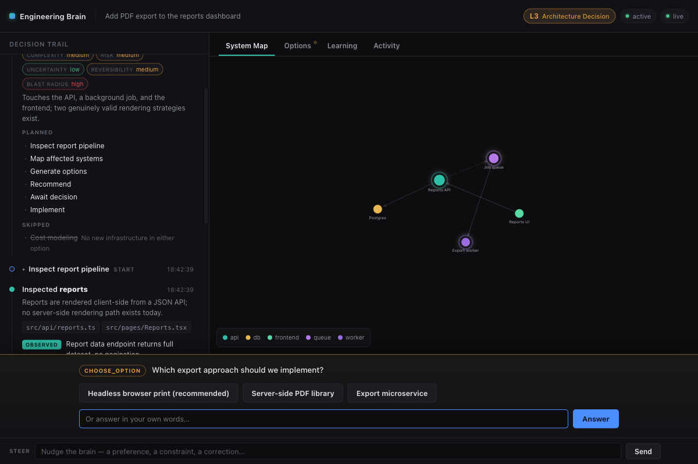
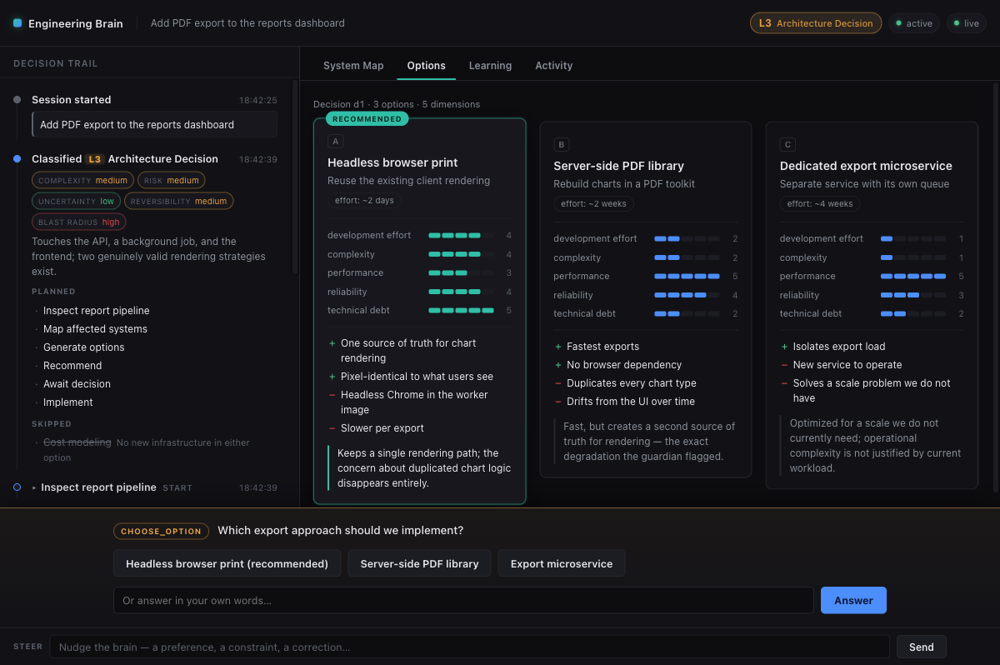
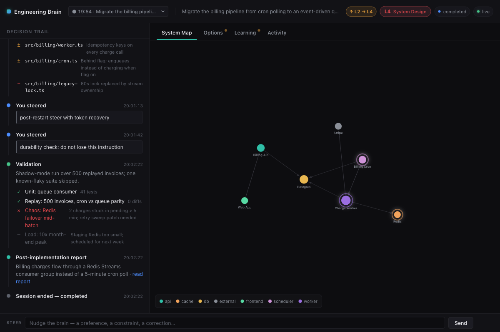
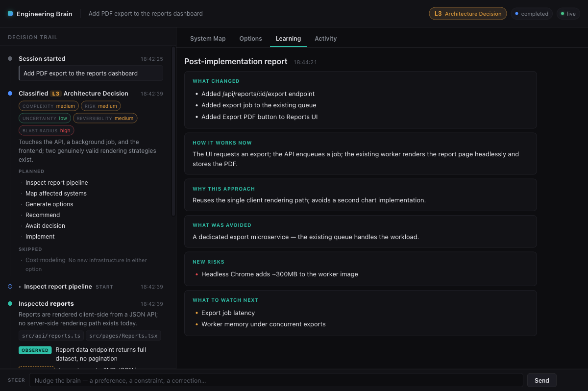

# Engineering Brain

**An engineering judgment layer for Claude Code — with a live visual cockpit for watching the agent think.**

Most AI coding loops are reactive: request → code → done. Repeated over months, that quietly produces slower systems, duplicated logic, hidden coupling, and architectural decisions nobody consciously made.

Engineering Brain replaces that with proportional judgment. It is not a system that follows more steps — it is a system that **understands when more steps are necessary**. A typo fix goes straight to implementation. A change that touches four systems triggers architecture inspection, genuinely distinct options, honest trade-off comparison, and a human decision — made with one click in a live web cockpit.



## What it does

- **Classifies every request into workflow levels 0–4** (Direct → Guided → Investigate → Architecture Decision → System Design) by scoring complexity, risk, reversibility, uncertainty, and blast radius — then **re-evaluates dynamically**, escalating when inspection reveals hidden scope and de-escalating when the existing abstraction already covers it.
- **Inspects the real system, not its assumptions** — builds a living architecture map from actual code, with every claim labeled `observed / measured / inferred / estimated / unknown`. Speculation is never presented as measurement.
- **Generates opinionated options** for genuine architecture decisions — fastest / recommended / scale-first — and says plainly why the losers lose ("Option C solves problems we do not have").
- **Acts as a guardian** — 11 architectural-degradation checks (second source of truth, unnecessary coupling, premature optimization, hidden dependencies…) that interrupt only when the concern is meaningful.
- **Streams its reasoning to a live cockpit** — a local web app where you watch classification, inspection, the system map, concerns, and options arrive in real time, and approve decisions with a click.
- **Learns after implementation** — reports what changed, why this approach, what was avoided, new risks, and what to watch next; then updates the system map.
- **Writes high-quality GitHub issues** after understanding the problem — because an idea is not automatically a task.







## Install

As a Claude Code plugin (recommended):

```
/plugin marketplace add aatmik-panse/engineering-brain
/plugin install engineering-brain@engineering-brain
```

Or manually, as a personal skill:

```bash
git clone https://github.com/aatmik-panse/engineering-brain.git
ln -s "$PWD/engineering-brain/skills/engineering-brain" ~/.claude/skills/engineering-brain
```

Requirements: Claude Code, Node.js ≥ 18. The cockpit runtime has **zero npm dependencies** and binds to `127.0.0.1` only.

## Use

Just make requests. The skill classifies them itself:

- Trivial changes (L0/L1) get **no ceremony** — no cockpit, no questions, no options. By design.
- Anything Level 2+ boots the cockpit automatically, or say **"show me"** / **"open the cockpit"** at any time.
- The agent shares one URL (e.g. `http://127.0.0.1:8641/?session=…`). Open it and watch: the decision trail on the left, the system map / options / learning tabs in the center, and a decision dock that appears when the agent needs you. Clicking **Approve Option B** in the UI is delivered straight to the waiting agent. A steer box is always available to nudge it mid-flight.

Every session is journaled append-only under `.engineering-brain/` in your project (gitignore it — this repo's `.gitignore` shows how). Human decisions survive server restarts; the journal is canonical.

## Anatomy

```
skills/engineering-brain/
  SKILL.md                 # the hot path: classification loop, level table, the 10 rules
  reference/               # 10 deep docs: levels, classification rubric, guardian checks,
                           # options, failure analysis, scaling/cost honesty, issue template,
                           # post-implementation learning, system mapping, cockpit protocol
  scripts/                 # zero-dependency Node runtime: brain.mjs (boot), brain-server.mjs
                           # (HTTP + SSE + append-only journal), emit / poll / status / stop
  ui/                      # the cockpit: vanilla JS, no build step, works fully offline
design/
  VISION.md                # the product vision this skill implements
  CONTRACT.md              # the authoritative event/endpoint/CLI contract
```

The cockpit architecture (local helper server + browser UI + bidirectional event loop + durable journal) is modeled on the battle-tested *live mode* pattern pioneered by the impeccable skill family: a local helper server, structured events over SSE, and human decisions flowing back to the agent through a long-poll loop.

## The 10 rules it lives by

1. Don't blindly implement the literal request if a better solution exists.
2. Don't always think deeply — think deeply when the expected value justifies it.
3. Don't always ask questions — ask only when uncertainty materially affects the outcome.
4. Don't always create multiple options — only when genuinely useful.
5. Don't always visualize — visualize when it improves understanding.
6. Don't overengineer — the most scalable architecture is not automatically the best.
7. Use evidence; label claims observed/measured/inferred/estimated/unknown.
8. The agent may recommend against a proposed solution.
9. Keep humans in meaningful architectural decisions.
10. Optimize for correctness, simplicity, understandability, maintainability — not maximum abstraction.

## License

[MIT](LICENSE)
